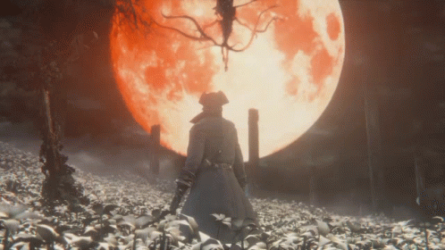

  

  

  

  
  

  

<h2 align="center">About Me</h2>

  Full Stack Developer working at a web development company, building and maintaining web applications and digital solutions.

  Interested in exploring new technologies, solving real-world problems and developing useful software.
  I enjoy working on projects from concept to implementation, exploring different areas of software development,
  and creating tools that improve everyday workflows.

<table align="center">
  <tr>
    <td><b>Software Development</b></td>
    <td>Web applications, backend systems and desktop software</td>
  </tr>
  <tr>
    <td><b>Integrations</b></td>
    <td>APIs, third-party services and workflow automation</td>
  </tr>
  <tr>
    <td><b>Problem Solving</b></td>
    <td>Building practical solutions and exploring new approaches</td>
  </tr>
  <tr>
    <td><b>Open Source</b></td>
    <td>Personal projects, experimentation and community contributions</td>
  </tr>
</table>

  

<h2 align="center">Technologies</h2>

<b>Backend</b> 

<b>Frontend</b> 

<b>Desktop & Mobile</b> 

<b>Databases</b> 

<b>Tools & DevOps</b> 

  

<h2 align="center">GitHub Activity</h2>

  
  

  

<h2 align="center">Contact</h2>

  Feel free to explore my repositories, check out my projects and connect!

  

  

